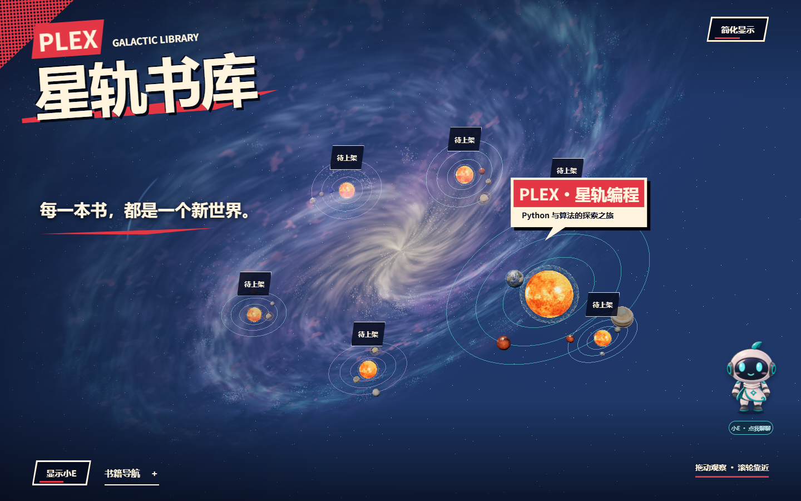
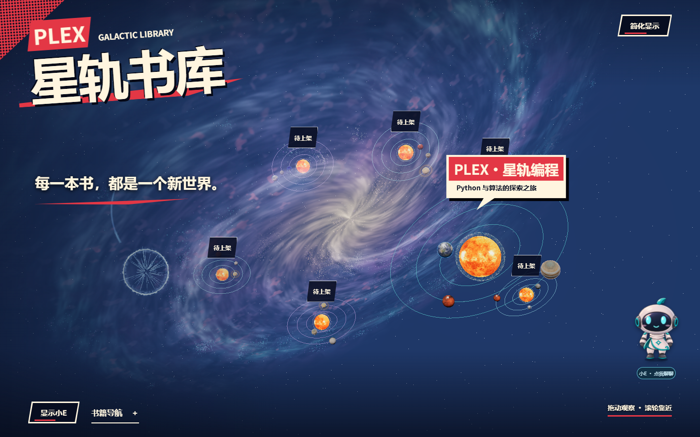

# 星球材质与粒子精修（2026-11-03）

## 设计约束

- 配色：深空 `#070d20`、星云蓝 `#647cae`、紫 `#8f68c9`、冰青 `#8ce1e6`、恒星暖金 `#ffc57d`、原漫画强调红 `#e33745`。
- 字体与布局：沿用本地思源字体、左上漫画标题、右侧主恒星系与底部探索入口；不重做阅读器。
- 视觉层次：纹理球面为主体，薄大气与有明暗的云层强调体积；星云承托空间，细星尘退后，长尾与冲击波响应操作。
- 审视原方案：仅增加点数或增亮发光不能解决纯色球和均匀噪点问题。本次改为有来源的实际贴图、不同材质与不同形态的动效。

## 来源

- Solar System Scope / INOVE：2K 等距柱状行星、太阳、云层与环带贴图，CC BY 4.0。原文件不改动；路径、字节数、SHA-256 见 `web/public/space/surfaces/manifest.json`。这些纹理只用于章节的艺术化身份，不表示章节对应真实天体，亦非科学精确图件。
- stegu/webgl-noise：固定提交 `22434e04d7753f7e949e8d724ab3da2864c17a0f`，直接纳入未修改的 `src/noise3D.glsl` 及 MIT 许可；用于恒星与特效的连续噪声。
- three.quarks / quarks.core：沿用锁定的 0.17.1，调用真正的 Trail 渲染能力。
- Three.js：沿用 0.187.0 和已有 MIT 许可；复用官方后处理组件。
- Galaxy Explorer：继续使用此前固定版本的旋臂底座，不新增上游摄影或音乐素材。

由于原贴图站在本地的 TLS 连接不可达，实际取件使用两个固定 GitHub 镜像：`RTF22/Orrery@6c81feb760cb36d7d83d1421aef257833ba9768e` 与 `elymas/solar-simulator@d34a9f973a7c4ad683eeb7d080b0accaba81e840`。前者的 ASSETS、后者的 README 均独立列出 Solar System Scope 的作者、资源和 CC BY 4.0；未引入它们的应用代码。完整署名见 `web/public/space/surfaces/ATTRIBUTION.md`。

## 实现范围

- 书库的 7 颗中心恒星使用太阳贴图与表面噪声，每个恒星系的 3 颗行星使用地表贴图；目录的 16 颗章节行星循环使用 8 种地表，不将材质名称当作新的书名或教材。
- 岩质地表具有轻微凹凸响应；海洋行星添加独立旋转的半透明云层与大气边缘；气态星体保留条纹，土星型星体使用透明环带贴图。
- 纹理按场景缓存，共 11 张、6.45 MiB；同一张图不因行星数量重复下载/上传。离开场景释放缓存，加载晚到时释放结果。加载失败使用已有可操作的文字／静态降级入口。
- 银河底图降低烘焙空间频率并柔化边缘，动态薄雾补充连续流动，背景细星尘降低亮度与密度感。恒星系轨道与书籍地址不变。
- Quarks Trail 渲染器取代点状彗星与爆发：连续尾迹、径向细丝、悬停汇聚；点击冲击波通过连续噪声产生不规则边缘。粒子不无限堆积，原冷却及最多 4 个同时发射器保留。
- 桌面采用 Three.js 官方柔光后处理；手机直接绘制。采样帧率低于原阈值时关闭并释放后处理目标，降低点数与 DPR；进入实体书关闭柔光以保持原封面清晰。
- 章节编号移到球面旁边，保留 44px 可访问触控目标和文字目录；新增球面点击与拖动区分，不因移动编号而让星体本身失去导航能力。
- 简化模式也使用贴图；小E、正文、书签、批注、草稿、账号和后端接口不变。

## 复现

贴图随源代码提交，正常安装、构建和浏览均不访问资源来源站。`scripts/fetch-space-surfaces.py` 仅供维护者重新获取原始文件；不是构建步骤。`npm run assets`（开发／构建前执行）中的 `scripts/audit-space.mjs` 验证每张图的字节数与 SHA-256，遗漏或损坏会失败。

依赖锁文件没有变化：没有新装渲染引擎，使用已有 Three.js / Quarks 的精确版本与新增固定提交的 GLSL 源码。智能搜索原有首次联网取模型行为不属于本次星空离线能力。

## 验证记录

- `npm run check`：类型检查、118 个上游页面／143 个书籍小节／136 个代码引用／250 张图片／292 组图解帧审计、学习内容审计、34 项 Node 测试和 7 项 Python 测试通过。
- `npm run build`：生产构建通过，新增 11 张图片逐一 SHA-256 校验通过。保留既有大于 500 kB 分块提示；三维模块仍按场景懒加载，未隐藏构建警告。
- Chrome 生产预览回归 26 项通过（`galaxy-home`、`stellar-library`、新增 `space-surfaces`）。包括 390／820／1440px、真实开书与封底点击保护、拖动与点击区分、继续阅读、章节选择、无 WebGL、缺图、延迟纹理在销毁后返回、无外站场景请求、无 GLSL 编译错误、账号/备份/小E状态和 axe 检查。
- 开发预览首轮为 24/25，一次小E伪时钟随机动作断言失败；未改动角色逻辑，随后独占浏览器运行的生产回归含原用例全部通过。不能将首轮描述为全通过。
- 实际截图审视发现开书时残留爆发尾迹，已在进入书体观察／打开封面时显式清理；补充书体阶段粒子数为 0 的回归断言。
- 最后清理改动后重新通过类型检查、生产构建与 10 项有针对性的生产版回归（六项贴图测试、三种尺寸完整开书流程、发射冷却与回收）；书体阶段粒子数为 0 的新断言通过。

### 帧率记录与边界

Windows、Chrome 159、ANGLE / Intel UHD Graphics / D3D11，生产预览，每场景加载完成后采样约 9 秒；表格为首个 4 秒窗口与随后窗口的 rAF 帧率。所有窗口在同一台桌面机器上运行，**窄视口不等于手机硬件**；这些是自动化浏览器采样，不是设备普适保证。

| 视口宽度 | 银河：首窗 → 稳定窗 | 章节目录：首窗 → 稳定窗 |
| --- | --- | --- |
| 1440px | 50.0 → 61.0 fps | 145.5 → 165.0 fps |
| 820px | 83.2 → 98.9 fps | 148.5 → 165.0 fps |
| 390px | 145.4 → 163.5 fps | 139.6 → 164.8 fps |

这次采样未触发低帧率降级；手机路径默认不启用柔光。性能采样期间捕获到的场景外站请求和 WebGL／脚本错误均为 0。[原始采样记录](validation/space-surfaces/performance.json) 随文档保存；其余日志与截图位于本地忽略目录 `output/surfaces/`。手机真机帧率、屏幕阅读器和人工教学试用仍待人工验收，本轮不声称已完成。

### 实际运行截图

下面是浏览器实际渲染，不是效果图；静态截图不能展示连续拖尾和云层运动。

最初在 `codex/galaxy-particles-chibi-pet` 交付；随后按用户要求将完整功能纳入 main，见 [合并说明](MAIN_GALAXY_2026-11-03.md)。未另行执行线上部署。开发预览为 `http://127.0.0.1:5196/`。
