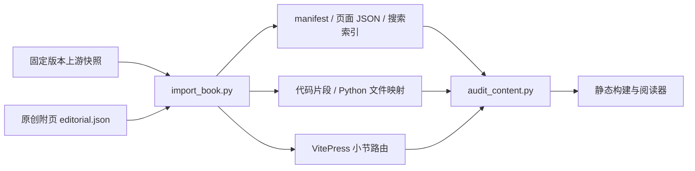

# 《PLEX · 星轨编程》首版技术总结

当前 v0.4 的逐页活动、动画、图表、板书、报告和数据迁移见 [v0.4 技术总结](LEARNING_V04.md)，发布验收见 [VALIDATION_V04.md](VALIDATION_V04.md)。以下保留初版工程沉淀。

## v0.2 更新入口

双模式阅读、稳定批注、IndexedDB、六类算法实验、24 道练习、CodeMirror 与备份恢复的最新实现见 [v0.2 学习工具技术总结](LEARNING_V02.md)。下文保留 v0.1 的实现背景与验证记录。

本文记录首版与鼠标拖拽增量的实现、关键取舍和维护入口。复现操作见 [克隆与复现](REPRODUCIBILITY.md)，具体测试证据见 [验证记录](VALIDATION.md)。

## 1. 交付形态

应用为静态 H5 数字教材，VitePress 构建，Vue 自定义阅读器负责展示。所有教材、图解、字体、Python 执行环境与 H5P 练习从同一站点加载，无需 Flask、数据库、账号或成绩服务器。开发时使用 VitePress dev，验收时使用 VitePress preview 提供构建成品。

全书为 129 节：118 个固定版本《Hello 算法》教材页、11 个 PLEX 附页。上游原序、第 0 章前言和第 1—15 章保留，第 16 章在附录区；纸质书宣传页和网站首页只保留来源快照。编者和出版信息未提供的部分仍为“待填写”。

| 层 | 版本 / 入口 | 职责 |
| --- | --- | --- |
| 构建与路由 | VitePress 1.6.4 | 小节独立地址、静态 HTML、资源构建 |
| 阅读界面 | Vue 3.5.22 / TypeScript 5.9.3 | 分页、导航、搜索、弹层、状态 |
| 翻页 | StPageFlip（page-flip）2.0.7 | 当前小节 HTML 纸页、卷页和阴影 |
| 练习 | h5p-standalone 3.8.2 / Interactive Book 1.11.11 | 三道二分查找题、评分与反馈 |
| Python | Pyodide 314.0.7 | 本机浏览器 Worker 内执行完整源文件 |
| 数学与字体 | KaTeX 0.16.22 / Fontsource | 公式及 Noto Serif SC、Noto Sans SC、JetBrains Mono |
| 验证 | Playwright 1.56.1 / Node test / Python unittest | 内容守恒、交互和运行时回归 |

Node 依赖树由 `package-lock.json` 固定；Python 直接依赖见 `requirements.txt`，可复现安装使用包含传递依赖的 `requirements.lock.txt`。字体和软件许可随站点构建。

## 2. 内容导入与来源追溯

上游固定为 `krahets/hello-algo@350f483801b2badb95180047aa82cadb825852a2`，原始快照在 `content/upstream/hello-algo/`，无需每次联网获取。`.gitattributes` 对上游及 H5P 原始文件禁用换行转换，避免 Windows 克隆后 SHA-256 校验失败。

导入器转换 MkDocs 提示框、折叠块、公式、脚注、属性与内部链接。图解步骤生成动画帧记录，不丢弃后续帧。代码引用解析为真实文件与片段，Python 使用 AST，其他语言结合声明、类范围及括号边界处理；无法解析时中止导入。需要整文件展示的语言实现明确标记为 `file-implementation`。

导入配置显式禁用 `pymdownx.highlight` 的可选 Pygments 处理，统一输出代码文本与语言 class。干净克隆验收曾暴露系统有无 Pygments 导致代码 HTML 不同的问题；现在相同锁定依赖可稳定再生，不借用全局 Python 包。

数据规模：136 个代码引用、1,865 个语言版本、14 种语言、39 组动画 / 292 帧。页面 JSON 记录来源路径、提交、来源 SHA-256 与转换说明。`audit_content.py` 检查页面覆盖、代码可追溯性、站内链接及锚点、本地图片与帧、空代码和残留转换标记。

`content/editorial.json` 和 `content/h5p/binary-search/` 是独立原创数据。重复导入只更新生成内容，不覆盖这两处；日常修改内容应编辑来源再导入，避免直接改生成 JSON。

## 3. 阅读模型与真实分页

最小数据契约位于 `web/.vitepress/theme/types.ts`：

| 契约 | 用途 |
| --- | --- |
| `BookManifest` / `BookSection` | 全书顺序、章节归组、稳定 ID、路由和来源 |
| `ReadingLocator` | `sectionId + blockId + offset`，定位内容而非物理页 |
| `CodeExample` / `CodeVariant` | 语言、片段、完整源文件、来源链接与可运行标记 |
| `ActivityRecord` | 内容版本、本地答题状态、得分和完成状态 |

`Layout.vue` 仅加载当前小节，预取相邻小节；搜索首次打开时加载独立索引。正文放入不可见测量区，等待字体、图片加载并渲染公式，再由 `pagination.ts` 测量分页。段落和列表可拆分，标题与后续内容相邻，图片与图注成组，过长代码或宽表格通过“展开阅读”访问完整内容。

≥1024 px 使用双页，其余单页。重排前保存内容锚点，重排后查找对应页。URL `/read/<section>#<block>@<offset>` 与同一套定位数据用于目录、搜索、书签、刷新恢复及继续阅读。页码随屏幕变化，不作为持久化键。

VitePress 接管小节路由；页内位置更新保留 `history.state`，否则浏览器后退可能失效。阅读器自定义链接区域使用 `vp-raw`，防止 VitePress 与事件委托重复处理点击。

## 4. 鼠标拖拽与组件隔离

StPageFlip 原生全页鼠标处理会与文本选择及交互内容争用事件。当前保持 `useMouseEvents:false`，由 `page-drag.ts` 在左右外缘 24 px 内启动 Pointer Events 拖拽。正文、链接、表单与 `data-action` 控件保留原交互。

拖动超过 6 px 后启用翻页：将指针坐标转换到 StPageFlip 渲染区，固定初始翻页方向，调用该固定版本的 `startUserTouch`、`getFlipController().start`、`userMove`、`userStop` 实现跟手卷页与阴影。类型声明在 `page-flip.d.ts`，升级翻页库时需核对这些 API 并跑拖拽测试。

当前小节内部由翻页库决定释放后的完成或回弹；封面和章节边界使用透视旋转过渡，完成后加载相邻小节。这里没有将全书预先挂载到 DOM，也没有将相邻小节伪装成当前小节的重复页。

指针捕获允许鼠标移出纸面后继续拖动。Escape、失焦、取消、窗口变化及卸载时清理拖动状态。只抑制本次拖动产生的尾随 click；新一次 pointerdown 清除抑制，避免拖完后代码按钮短暂失灵。减少动态效果模式下省略连续卷页动画。

翻页库会在单页模式克隆 HTML。书页因此仅包含静态 HTML 与委托按钮；代码编辑器、图像查看器、展开阅读及 H5P 均置于翻页容器之外的 Vue 弹层，避免双实例、重复监听和状态丢失。

## 5. Python 执行链路

`CodePanel.vue` 展示完整示例、语言切换、编辑、复制、运行、停止、重置与输出。非 Python 语言只查看与复制，不声称可在浏览器执行。

`web/public/python-worker.js` 是模块 Worker。首次执行才加载站内 Pyodide；根据 `python-files.json` 挂载原作 Python 文件与辅助模块，设置全局及当前文件目录的 `sys.path`，使用真实 `__file__` 与 `__name__='__main__'` 执行演示入口，避免仅定义函数而没有输出。

默认执行上限 10 秒；停止或超时终止 Worker，下一次重建。初始化失败显示重试，阅读仍可继续。输出限制 50,000 字符。73 个被引用的独立 Python 源文件均有执行验收，包括二分查找、排序、链表、树与图。

## 6. H5P 静态播放与恢复

练习采用真实 Interactive Book，三题分别覆盖概念、步骤与复杂度。`content/h5p/binary-search/` 包含内容和 9 个固定依赖库；`runtime-lock.json` 为逐文件完整性记录，构建复制前必须验证。

`H5PPanel.vue` 外层 iframe 加载本地 `h5p-player.html`，Standalone 再创建内层 iframe。真正的 H5P 实例和 xAPI dispatcher 位于内层，监听和保存须对内层操作。

本机保存 `getCurrentState()`、得分和完成标志；初始化以 `contentUserData[0].state` 注入恢复状态，同时设置非零 `saveFreq`，满足 H5P core 的恢复条件。关闭面板前同步保存。没有成绩服务器，不能将本机记录用于班级成绩同步。

MultiChoice 恢复已选答案与分数，但不保证恢复反馈面板展开；读者可以再次点“检查答案”。更新题目结构时应更新内容版本与 localStorage 键，避免旧答案套用到新题。

## 7. 可复现性与资源归属

必须进 Git：源码、导入器、原始教材快照、生成教材数据、小节路由、本地图解 / 星图、原创附页、H5P 内容与库、原始封面、锁文件、许可、测试与文档。封面来源已迁入 `assets/references/`，不再引用原附件临时路径。

不进 Git：`node_modules`、`.venv`、构建目录、重复拷贝的 `web/public/vendor` / `h5p` / `images` / `licenses`、本机测试日志与浏览器缓存。`npm ci`、锁定 Python 安装及 `npm run build` 从受版本控制的输入生成这些目录。首次安装需要网络；运行教材所需的资源由本地 HTTP 服务提供。已有浏览器阅读进度不随仓库复制。

字体布局与分页会受窗口尺寸、浏览器和系统字体渲染差异影响；复现的是完整内容、视觉方案与交互功能，不保证跨平台像素与物理页码完全一致。未部署 Service Worker，因此“资源本地化”不等于离开 HTTP 服务仍可打开。

完整分发包由 `scripts/package-release.py` 组装 Git 跟踪文件与生产构建，记录提交和逐文件 SHA-256，排除环境、缓存和浏览器数据。`scripts/serve-dist.mjs` 使用 Node 内置 HTTP / 文件系统模块，提供干净小节路由和 WASM / 模块脚本 MIME；解压 ZIP 即可启动，无需先安装项目依赖。

## 8. 测试与维护经验

- `npm run check`：Vue / TypeScript、内容审计、导入与定位单元测试。
- `npm run build`：准备资源、验证内容、静态生产构建。
- `npm run test:e2e`：全部小节三尺寸分页审计、阅读导航恢复、Python 73 个示例与异常流程、H5P 评分恢复、鼠标拖拽。
- 干净克隆用独立目录、独立 Python venv、`npm ci` 和独立测试端口运行生产成品，避免误验收原工作区服务。
- 静态预览进程可能缓存旧构建资源映射；重建后应重启 preview，再刷新页面，避免旧哈希脚本 404。
- 来源哈希不一致先检查换行处理；不应通过删除校验来绕过缺文件或改动。
- 后续新增互动保持固定宿主，不在 StPageFlip 克隆节点内挂有状态 Vue 组件。

当前完成的是本机使用的首版。账号同步、在线编辑后台、全书题库扩充、EPUB / PDF 导出仍是独立后续工作；所有浏览器兼容性尚未全面验证。
