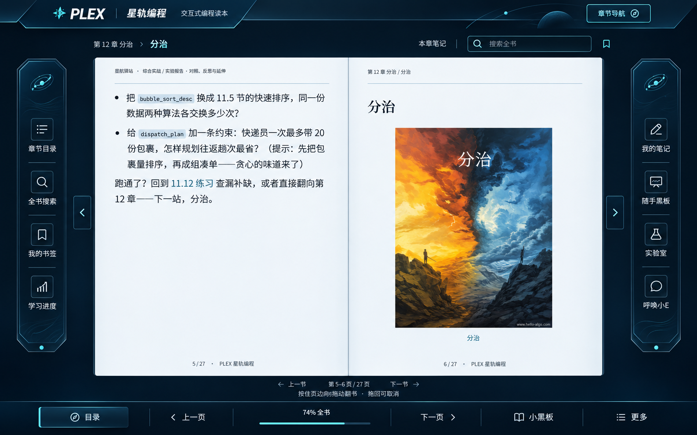

# 星轨书库与蓝黑色阅读工具栏

## 设计与实现

首页以全屏三维星域为主体，书名与入口靠近对应星体。七个星域分别采用海洋、光环、冰晶、双星、沙丘、冰巨星和碎星轮廓；只有「星轨编程」可阅读，其余明确标为待上架。

章节页保留完整的 16 章文字目录，提供搜索和当前位置提示；旁边是可旋转的三维场景。手机使用编号星图及下方章名列表。完整书籍编排可展开查看前言、章节及附页。减少动态效果偏好默认显示文字目录，WebGL 或贴图失败也能继续进入章节。

阅读页左侧提供章节目录、全书搜索、书签、进度，右侧提供笔记、黑板、实验室、小E。工具栏采用蓝黑色面板、冰青边线、轨道徽记和独立图标底座。窄屏保留底部导航和「更多」全部入口；沉浸模式隐藏两侧工具栏。翻页宽度为侧栏预留空间。

主色：`#050d19`、`#0a1b2e`、`#102c44`；强调色：`#8be5f5`。正文保留浅色纸面及原有深色阅读主题设置。

## 小E模型

- 文件：`web/public/brand/little-e-3d/model.glb`，随站点发布，本地加载。
- 输入：已有角色原图 `web/public/brand/little-e-front.png`。
- 服务 / 工具：Tripo / `tripo_image_to_3d`。
- 模型版本：`v3.1-20260211`，智能低面数，标准纹理。
- 任务：`6aa8738a-68a0-4145-98c7-3d03e59614f4`。
- 唯一计费任务：40 credits；等待、下载、用量查询免费，总计 40 credits。
- 没有骨骼绑定或生成骨骼动画；挥手为原模型姿态，悬浮和轻微转身为本地程序动作。

模型在 Three.js 中归一化尺寸并校正朝向，参与实际场景光照。离开页面、切换简化模式及晚到的加载回调都会释放几何体、材质和纹理。模型加载失败单独提示，不影响章节导航。轨道使用同一条解析椭圆计算路径与星体位置，有限长度渐隐光迹随时间移动；暂停和减少动态效果会停止自动运动。

## 视觉参考

参考图：

由内置 `image_gen` 工具编辑实际页面截图生成，仅作为设计参考；运行时工具栏由 Vue、CSS 与 Lucide 图标实现，不把截图作为界面。

生成提示词：

> Use case: ui-mockup. Edit this existing PLEX Chinese digital textbook UI screenshot into a polished high fidelity design reference. Preserve the central open book, Chinese textbook contents, page navigation and small friendly white/cyan robot. Redesign BOTH left and right toolbars and the surrounding chrome in a predominantly BLUE BLACK palette (#050d19, #0a1b2e, #102c44) with restrained icy cyan (#8be5f5) highlights. Replace the pale vertical pills with beautiful compact spacecraft instrument rails: dark translucent glass, subtle fine illuminated outlines, layered blue-black metal, discreet topographic/orbital etched details, elegant sharp corner accents, clear outline icons inside small dark square wells and legible Chinese captions. Left rail four controls: 章节目录, 全书搜索, 我的书签, 学习进度. Right rail: 我的笔记, 随手黑板, 实验室, 呼唤小E. Add a small cyan orbital emblem at top of each rail, tiny status indicator at foot, refined separators. Keep toolbars narrow and balanced so the book remains dominant. Calm midnight-blue background, much less noisy than existing graphic; no mint/white toolbars, no large purple gradients, no excessive neon or game clutter. Realistic implementable web UI, not a game HUD with illegible decorations. Landscape 16:10 composition, retain original book layout and geometry.

## 验证

执行 `npm run check`、`npm run build`；浏览器覆盖首页与翻书、章节目录、纹理及模型故障恢复、桌面工具栏、响应式排版和无障碍。开发预览使用端口 5196，生产构建使用独立预览端口验证，避免旧入口文件缓存影响结果。

最终结果：类型、内容、输入资源和学习内容检查通过；36 项 Node 测试、9 项 Python 测试通过；11 项首页浏览器用例通过，最后一次生产构建上的 23 项模型、星图和侧栏用例通过，合计 34 项专项浏览器用例。额外验证了 390px、820px 下的全部 147 个正文区段，以及手机翻页、缩放和刷新。

额外执行的旧桌面用例有 3 项失败：1440px 全书审计、封面至书签、跨章节历史。它们仍断言双页章边界的左页为当前位置，而现有实现会激活右页。已在干净的原始 `main`（`93b5baa5f3d2b5998fa82da222d18ce0ab44d236`）独立运行并复现完全相同的 3 处失败。本次未修改这项已有阅读规则，也未放宽这些用例。构建仍有原有的大于 500kB 分块提示。
